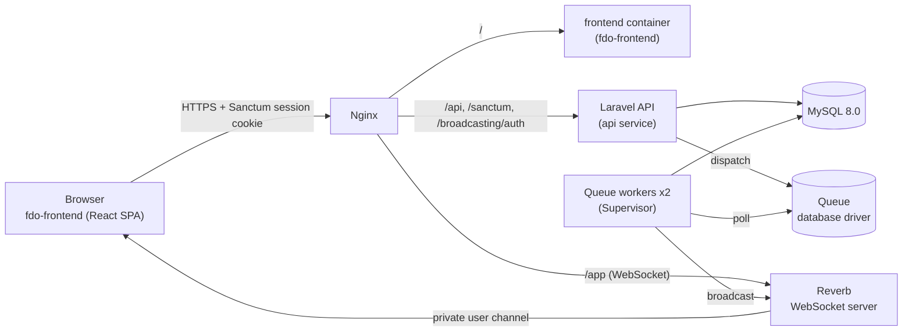
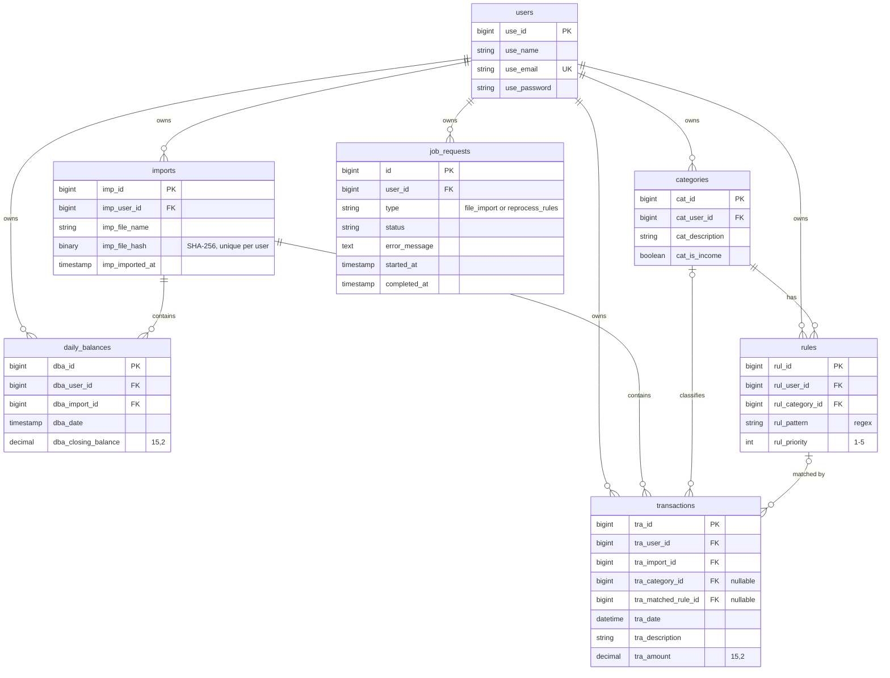

# FDO API — Financial Data Overview

**English** · [Português](README.pt-br.md)

> REST API for a personal finance dashboard: bank statement import, rule-based transaction categorization processed in background jobs, and real-time job status over WebSockets.

**Frontend:** [fdo-frontend](https://github.com/AntonioHenriqueGF/fdo-frontend) · **Live demo:** <!-- TODO(author): add the public demo URL --> · **Infrastructure:** [Docker image structure](DOCKER_IMAGES_STRUCTURE.md) · [Nginx configuration](nginx/README.md)

---

## Features

- **SPA authentication with Sanctum:** cookie-based sessions with CSRF protection (`statefulApi()`), covering sign-up, login, logout and `GET /api/me`.
- **Statement import:** the SPA parses the bank's CSV, the user maps its columns, and the API receives normalized rows at `POST /api/import`. Re-importing the same file is rejected by a per-user SHA-256 hash, and deleting an import also deletes the transactions and daily balances it created.
- **Categories and rules:** user-defined categories flagged as income or expense. Each category has rules: a regex pattern plus a priority from 1 to 5.
- **Rule reprocessing:** `POST /api/reprocess-rules` queues a job that re-applies the user's current rules to all of their transactions.
- **Transactions and daily balances:** CRUD with date-range and category filters and offset/limit pagination, plus daily and monthly aggregates (overall and per category) and a daily reconciliation against closing balances.
- **Real-time job status:** when a background job completes or fails, an event is broadcast through Laravel Reverb on a private channel scoped to the user.

## Technical highlights

**Background processing with tracked job status.** Imports and rule reprocessing can touch thousands of rows, so they run on the queue instead of inside the HTTP request. Both jobs extend an abstract `FDOJobClass` (template method). It records each run in a `job_requests` table (`pending` → `in_progress` → `completed` / `failed`, with timestamps and the error message) and calls the concrete `process()`. Two `queue:work` processes are kept alive by Supervisor inside the `worker` container (`--tries=3 --timeout=120`). Jobs that exhaust their retries land in `failed_jobs`.

**Atomic, idempotent imports.** An import runs in one database transaction: it saves the import, its daily balances and its transactions. A failure therefore leaves no partial data. A unique `(imp_user_id, imp_file_hash)` constraint on a `BINARY(32)` column makes the same file impossible to import twice for the same user. Every transaction and daily balance keeps a foreign key to its import, so deleting the import reverses it completely.

**Rule engine.** The user's rules are loaded once per run, ordered by `rul_priority` (highest first). Each rule's pattern is evaluated as a regular expression against the transaction description. The **first** rule that matches wins: it sets the transaction's category and records which rule matched (`tra_matched_rule_id`), so every categorization is traceable. Rules are applied on import, on manual transaction creation and on demand through reprocessing. Reprocessing walks the user's transactions in chunks of 1,000 (`chunkById`) to keep memory flat.

**Real-time feedback.** `JobRequestUpdated` implements `ShouldBroadcast` and is emitted as `job-request.updated` on `private-App.Models.User.{userId}` when a job completes or fails. `routes/channels.php` authorizes the subscription only when the authenticated user's `use_id` equals the channel's `{id}`. The event payload carries the job type, status, timestamps and error. `GET /api/job-requests/{id}` returns the same data on request.

**Containerized deployment.** One PHP 8.3 image is reused by four services that differ only in their command: `api`, `worker`, `reverb`, and `migrate` (a one-shot service that runs `migrate --force` and exits). Nginx is the only published service. It routes by path to the frontend, the API and Reverb (WebSocket upgrade on `/app`), so the browser sees a single origin and the Sanctum cookies stay first-party. MySQL is never exposed outside the Docker network. The production override adds TLS with Certbot, HTTP→HTTPS redirect, security headers and API rate limiting (`20 r/s`, burst 40).

### Data isolation

Every user-owned table (`imports`, `transactions`, `daily_balances`, `categories`, `rules`, `job_requests`) has a direct foreign key to `users`. The redundancy is deliberate: ownership can be checked on a single row without joins. Isolation is enforced explicitly in the data-access layer: each model or use-case query filters by the authenticated user's id (`*_user_id = Auth::id()`). Updates and deletes include that filter in the `WHERE` clause, so another user's id simply matches nothing and the request returns an error. The project does not use Policies or Eloquent global scopes. Composite indexes on `(user_id, date)` and `(user_id, category_id)` keep these scoped queries index-backed.

## Architecture



The queue uses Laravel's `database` driver, so jobs are stored in MySQL's `jobs` table. No extra broker is needed.

## Data model

Generated from `database/migrations` (relevant columns only). The table prefixes (`use_`, `imp_`, `tra_`, ...) are a deliberate naming convention.



A daily balance is stored separately from transactions on purpose. The bank's closing balance can't be derived from the transactions in the statement, and the reconciliation endpoint compares the two.

## API overview

All endpoints are under `/api`. "Session" means a Sanctum cookie session is required (`auth:sanctum`). Every state-changing request from the SPA must also carry the `X-XSRF-TOKEN` header, obtained from `GET /sanctum/csrf-cookie`. Responses share the envelope `{ "status", "message", "data" }`.

| Method | Endpoint | Description | Auth |
|---|---|---|---|
| **Auth** | | | |
| GET | `/sanctum/csrf-cookie` | Issue the XSRF cookie | Public |
| POST | `/api/signup` | Create an account and start a session | Public |
| POST | `/api/login` | Log in (session regenerated) | Public |
| POST | `/api/logout` | Log out and invalidate the session | Session |
| GET | `/api/me` | Current user | Session |
| POST | `/broadcasting/auth` | Authorize a private Reverb channel | Session |
| **Imports** | | | |
| POST | `/api/import` | Queue the import of normalized statement rows | Session |
| GET | `/api/import` | List the user's imports | Session |
| DELETE | `/api/import/{importId}` | Delete an import and everything it created | Session |
| GET | `/api/job-requests/{jobRequestId}` | Status of a background job | Session |
| **Categories & rules** | | | |
| GET · POST | `/api/categories` | List / create categories | Session |
| PUT/PATCH · DELETE | `/api/categories/{category}` | Rename / delete a category (and its rules) | Session |
| PATCH | `/api/categories/{id}/income` | Toggle the income flag | Session |
| GET · POST | `/api/categories/{category}/rules` | List / create rules of a category | Session |
| PUT/PATCH · DELETE | `/api/categories/{category}/rules/{rule}` | Update / delete a rule | Session |
| POST | `/api/reprocess-rules` | Queue re-categorization of all transactions | Session |
| **Transactions** | | | |
| GET · POST | `/api/transactions` | List (filters: `date_start`, `date_end`, `category_id`; pagination: `limitStart`, `limitEnd`) / create | Session |
| PUT/PATCH · DELETE | `/api/transactions/{transaction}` | Update / delete a transaction | Session |
| GET | `/api/transactions/daily` · `/monthly` | Net total per day / month | Session |
| GET | `/api/transactions/categories/total` · `/daily` · `/monthly` | Totals per category (filters: `date_start`, `date_end`, `category_id[]`) | Session |
| POST | `/api/transactions/reconciliation/daily` | Daily totals alongside closing balances | Session |
| **Daily balances** | | | |
| GET · POST | `/api/daily-balances` | List (date filters, pagination) / create | Session |
| PUT/PATCH · DELETE | `/api/daily-balances/{daily_balance}` | Update / delete a balance | Session |
| GET | `/api/balance/daily` · `/monthly` | Closing balance per day / last closing balance per month | Session |

To list every registered route:

```bash
docker compose exec api php artisan route:list --path=api
```

## Tech stack

| Layer | Technology | Version | Purpose |
|---|---|---|---|
| Language | PHP | 8.3 (`php:8.3-cli`) | Runtime for API, workers and Reverb |
| Framework | Laravel | 13.19 | HTTP, Eloquent, queues, broadcasting |
| Auth | Laravel Sanctum | 4.3 | Cookie-based SPA authentication + CSRF |
| Real-time | Laravel Reverb | 1.10 | Self-hosted WebSocket server (Pusher protocol) |
| Database | MySQL | 8.0 | Persistence, sessions, cache and queue (`database` driver) |
| Process manager | Supervisor | Debian package | Keeps two queue workers running |
| Web server / proxy | Nginx | `nginx:latest` | Path routing, TLS termination, rate limiting, headers |
| TLS | Certbot | `certbot/certbot` | Let's Encrypt certificates (production) |
| Containers | Docker + Docker Compose v2 | — | Dev/prod environments via compose overrides |
| Testing / style | Pest · Laravel Pint | 4.7 · 1.29 | Tests and code formatting |

## Getting started

### Prerequisites

- Docker with Docker Compose v2 (`docker compose`)
- The [fdo-frontend](https://github.com/AntonioHenriqueGF/fdo-frontend) repository, to use the UI

### 1. Configure the environment

```bash
cp .env.example .env
docker network create fdo_network   # shared with the fdo-frontend containers
```

Then set the variables below in `.env`. Example values are placeholders; never commit real secrets.

| Variable | Example | Notes |
|---|---|---|
| `APP_KEY` | *(generated)* | `docker compose run --rm api php artisan key:generate --show`, then paste the value |
| `APP_URL` | `http://localhost` | Public URL served by Nginx |
| `DB_CONNECTION` / `DB_HOST` / `DB_PORT` | `mysql` / `db` / `3306` | `db` is the compose service name |
| `DB_DATABASE` / `DB_USERNAME` / `DB_PASSWORD` | `fdo_api` / `root` / `<secret>` | Used by Laravel and by the `db` healthcheck |
| `MYSQL_DATABASE` / `MYSQL_ROOT_PASSWORD` | `fdo_api` / `<secret>` | Read by the `mysql:8.0` container on first start; keep in sync with `DB_*` |
| `QUEUE_CONNECTION` | `database` | Jobs are stored in MySQL |
| `SESSION_DRIVER` | `database` | |
| `SESSION_DOMAIN` | `localhost` | Domain the session cookie is issued for |
| `SESSION_SECURE_COOKIE` / `SESSION_SAME_SITE` | `false` / `lax` | Set `true` in production (HTTPS) |
| `SANCTUM_STATEFUL_DOMAINS` | `localhost` | Host(s) the SPA is served from; requests from them get cookie auth |
| `CORS_ALLOWED_ORIGINS` | `http://localhost` | Comma-separated; defaults to `*` if unset, so always set it |
| `BROADCAST_CONNECTION` | `reverb` | `.env.example` ships with `log` |
| `REVERB_APP_ID` / `REVERB_APP_KEY` / `REVERB_APP_SECRET` | `<id>` / `<key>` / `<secret>` | Required, or the broadcaster fails to boot |
| `REVERB_HOST` / `REVERB_PORT` / `REVERB_SCHEME` | `reverb` / `8081` / `http` | Where Laravel publishes events (internal network) |
| `REVERB_SERVER_HOST` / `REVERB_SERVER_PORT` | `0.0.0.0` / `8081` | Where the Reverb server listens |
| `NGINX_HTTP_PORT` | `80` | Dev only: host port published by Nginx |
| `NGINX_SERVER_NAME` | `api.example.com` | Production only: domain used by the TLS template |

### 2. Run in development

```bash
docker compose up -d --build
```

`docker-compose.override.yml` is applied automatically. It publishes Nginx on `NGINX_HTTP_PORT` and mounts `nginx/conf.d/dev.conf`. The `migrate` service applies all migrations once the database is healthy, then exits. To rerun migrations manually:

```bash
docker compose run --rm migrate
```

No demo data is seeded. Create an account through the frontend's sign-up page or with `POST /api/signup`. <!-- TODO(author): add a demo user seeder (DatabaseSeeder still uses the default Laravel columns) and document its credentials here, or keep this sentence. -->

### 3. Run in production

```bash
docker volume create certbot-ssl
docker compose -f docker-compose.yml -f docker-compose.prod.yml up -d --build
```

The production override publishes ports 80/443 and renders `nginx/templates/prod.conf.template` with `NGINX_SERVER_NAME`. It also adds the `certbot` service for Let's Encrypt certificates. The first-issuance flow and renewal are described in [nginx/README.md](nginx/README.md), and every image and service is detailed in [DOCKER_IMAGES_STRUCTURE.md](DOCKER_IMAGES_STRUCTURE.md).

### 4. Connect the frontend

The [fdo-frontend](https://github.com/AntonioHenriqueGF/fdo-frontend) is served **through this repository's Nginx**, so the SPA, the API and Reverb share one origin:

- **Development:** Nginx proxies `/` to `host.docker.internal:81`, the port published by the fdo-frontend dev compose. Open `http://localhost` (or your `NGINX_HTTP_PORT`).
- **Production:** Nginx proxies `/` to the `frontend` service on the shared `fdo_network`.

Because everything lives on the same host, `SANCTUM_STATEFUL_DOMAINS` and `SESSION_DOMAIN` only need that host (for example `localhost` or your domain). The SPA calls `/sanctum/csrf-cookie` before login or sign-up, then sends requests with credentials. For WebSockets, it connects with Laravel Echo to the same host on `/app`.

## Testing

```bash
php artisan test
```

The suite uses Pest 4. It currently includes a feature test that checks the per-category aggregate endpoints (total, daily, monthly), including that another user's transactions are excluded. Tests run against MySQL. Broader coverage is on the roadmap.

## Roadmap

<!-- TODO(author): confirm priorities and order. -->

- XLSX import alongside CSV
- Broader test coverage: imports, rule engine, data isolation per endpoint, broadcasting
- Centralized authorization with Laravel Policies or global scopes
- OpenAPI / Swagger documentation
- Eloquent API Resources for response shaping
- Date-range filters on the daily/monthly aggregate endpoints

## Related repositories

- [fdo-frontend](https://github.com/AntonioHenriqueGF/fdo-frontend): React + TypeScript SPA (Vite, MUI, Laravel Echo) that consumes this API

## Author

**Antonio Henrique** <!-- TODO(author): confirm the full name as you want it displayed -->

- LinkedIn: [linkedin.com/in/antonio-fournier](https://www.linkedin.com/in/antonio-fournier/)
- GitHub: [@AntonioHenriqueGF](https://github.com/AntonioHenriqueGF)
