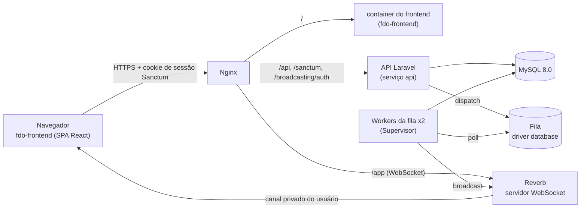
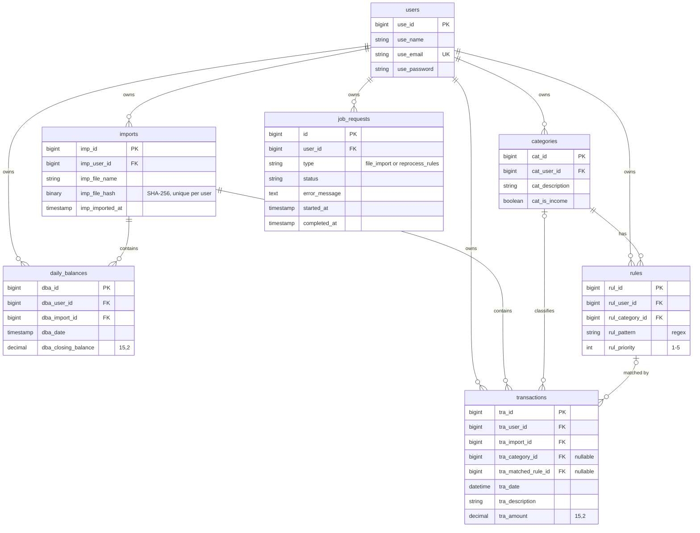

# FDO API — Financial Data Overview

[English](README.md) · **Português**

> API REST para um painel de finanças pessoais: importação de extratos bancários, categorização de transações por regras processada em jobs em segundo plano e status dos jobs em tempo real via WebSockets.

**Frontend:** [fdo-frontend](https://github.com/AntonioHenriqueGF/fdo-frontend) · **Demo:** <!-- TODO(author): adicionar a URL pública da demo --> · **Infraestrutura:** [Estrutura das imagens Docker](DOCKER_IMAGES_STRUCTURE.md) · [Configuração do Nginx](nginx/README.pt-br.md)

---

## Funcionalidades

- **Autenticação SPA com Sanctum:** sessão por cookie com proteção CSRF (`statefulApi()`), cobrindo cadastro, login, logout e `GET /api/me`.
- **Importação de extratos:** a SPA lê o CSV do banco, o usuário mapeia as colunas e a API recebe as linhas normalizadas em `POST /api/import`. Reimportar o mesmo arquivo é bloqueado por um hash SHA-256 por usuário, e excluir uma importação remove também as transações e os saldos diários que ela criou.
- **Categorias e regras:** categorias definidas pelo usuário e marcadas como receita ou despesa. Cada categoria tem regras: um padrão regex e uma prioridade de 1 a 5.
- **Reprocessamento de regras:** `POST /api/reprocess-rules` enfileira um job que reaplica as regras atuais do usuário a todas as transações dele.
- **Transações e saldos diários:** CRUD com filtros por período e por categoria e paginação por offset/limit, além de agregados diários e mensais (gerais e por categoria) e uma conciliação diária com os saldos de fechamento.
- **Status dos jobs em tempo real:** quando um job em segundo plano termina ou falha, um evento é transmitido pelo Laravel Reverb em um canal privado do usuário.

## Destaques técnicos

**Processamento em segundo plano com rastreamento de status.** Importações e reprocessamento de regras podem envolver milhares de linhas, por isso rodam na fila e não dentro da requisição HTTP. Os dois jobs estendem a classe abstrata `FDOJobClass` (template method). Ela registra cada execução na tabela `job_requests` (`pending` → `in_progress` → `completed` / `failed`, com timestamps e a mensagem de erro) e chama o `process()` concreto. Dois processos `queue:work` são mantidos ativos pelo Supervisor no container `worker` (`--tries=3 --timeout=120`). Os jobs que esgotam as tentativas vão para `failed_jobs`.

**Importações atômicas e idempotentes.** Uma importação roda em uma única transação de banco: ela grava a importação, os saldos diários e as transações. Uma falha, portanto, não deixa dados parciais. Uma constraint única em `(imp_user_id, imp_file_hash)`, sobre uma coluna `BINARY(32)`, impede que o mesmo arquivo seja importado duas vezes pelo mesmo usuário. Toda transação e todo saldo diário guardam uma chave estrangeira para a importação de origem, então excluir a importação a desfaz por completo.

**Motor de regras.** As regras do usuário são carregadas uma vez por execução, ordenadas por `rul_priority` (maior primeiro). O padrão de cada regra é avaliado como expressão regular sobre a descrição da transação. A **primeira** regra que casa vence: ela define a categoria da transação e registra qual regra casou (`tra_matched_rule_id`), de modo que toda categorização é rastreável. As regras são aplicadas na importação, na criação manual de transações e sob demanda pelo reprocessamento. O reprocessamento percorre as transações do usuário em blocos de 1.000 (`chunkById`) para manter o uso de memória constante.

**Feedback em tempo real.** `JobRequestUpdated` implementa `ShouldBroadcast` e é emitido como `job-request.updated` em `private-App.Models.User.{userId}` quando um job termina ou falha. O arquivo `routes/channels.php` só autoriza a inscrição quando o `use_id` do usuário autenticado é igual ao `{id}` do canal. O evento leva o tipo do job, o status, os timestamps e o erro. `GET /api/job-requests/{id}` devolve os mesmos dados sob demanda.

**Deploy em containers.** Uma única imagem PHP 8.3 é reaproveitada por quatro serviços que diferem só no comando: `api`, `worker`, `reverb` e `migrate` (serviço one-shot que roda `migrate --force` e encerra). O Nginx é o único serviço publicado. Ele roteia por caminho para o frontend, a API e o Reverb (upgrade de WebSocket em `/app`), então o navegador enxerga uma única origem e os cookies do Sanctum continuam first-party. O MySQL nunca é exposto fora da rede Docker. O override de produção acrescenta TLS com Certbot, redirecionamento HTTP→HTTPS, cabeçalhos de segurança e rate limiting na API (`20 r/s`, burst 40).

### Isolamento de dados

Toda tabela pertencente ao usuário (`imports`, `transactions`, `daily_balances`, `categories`, `rules`, `job_requests`) tem uma chave estrangeira direta para `users`. A redundância é proposital: a posse pode ser verificada em uma única linha, sem joins. O isolamento é aplicado de forma explícita na camada de acesso a dados: cada query de model ou de use case filtra pelo id do usuário autenticado (`*_user_id = Auth::id()`). Updates e deletes incluem esse filtro no `WHERE`, então o id de outro usuário simplesmente não encontra nada e a requisição retorna erro. O projeto não usa Policies nem global scopes do Eloquent. Índices compostos em `(user_id, date)` e `(user_id, category_id)` mantêm essas queries filtradas apoiadas em índice.

## Arquitetura



A fila usa o driver `database` do Laravel, então os jobs ficam na tabela `jobs` do MySQL. Nenhum broker adicional é necessário.

## Modelo de dados

Gerado a partir de `database/migrations` (apenas as colunas relevantes). Os prefixos das tabelas (`use_`, `imp_`, `tra_`, ...) são uma convenção de nomenclatura proposital.



O saldo diário é armazenado separadamente das transações de propósito. O saldo de fechamento informado pelo banco não pode ser derivado das transações do extrato, e o endpoint de conciliação compara os dois.

## Visão geral da API

Todos os endpoints ficam sob `/api`. "Sessão" indica que é necessária uma sessão Sanctum por cookie (`auth:sanctum`). Toda requisição da SPA que altera estado também precisa enviar o cabeçalho `X-XSRF-TOKEN`, obtido em `GET /sanctum/csrf-cookie`. As respostas seguem o envelope `{ "status", "message", "data" }`.

| Método | Endpoint | Descrição | Auth |
|---|---|---|---|
| **Autenticação** | | | |
| GET | `/sanctum/csrf-cookie` | Emite o cookie XSRF | Pública |
| POST | `/api/signup` | Cria uma conta e inicia a sessão | Pública |
| POST | `/api/login` | Login (sessão regenerada) | Pública |
| POST | `/api/logout` | Logout e invalidação da sessão | Sessão |
| GET | `/api/me` | Usuário atual | Sessão |
| POST | `/broadcasting/auth` | Autoriza um canal privado do Reverb | Sessão |
| **Importações** | | | |
| POST | `/api/import` | Enfileira a importação das linhas normalizadas do extrato | Sessão |
| GET | `/api/import` | Lista as importações do usuário | Sessão |
| DELETE | `/api/import/{importId}` | Exclui uma importação e tudo o que ela criou | Sessão |
| GET | `/api/job-requests/{jobRequestId}` | Status de um job em segundo plano | Sessão |
| **Categorias e regras** | | | |
| GET · POST | `/api/categories` | Lista / cria categorias | Sessão |
| PUT/PATCH · DELETE | `/api/categories/{category}` | Renomeia / exclui uma categoria (e suas regras) | Sessão |
| PATCH | `/api/categories/{id}/income` | Alterna a marcação de receita | Sessão |
| GET · POST | `/api/categories/{category}/rules` | Lista / cria regras de uma categoria | Sessão |
| PUT/PATCH · DELETE | `/api/categories/{category}/rules/{rule}` | Atualiza / exclui uma regra | Sessão |
| POST | `/api/reprocess-rules` | Enfileira a recategorização de todas as transações | Sessão |
| **Transações** | | | |
| GET · POST | `/api/transactions` | Lista (filtros: `date_start`, `date_end`, `category_id`; paginação: `limitStart`, `limitEnd`) / cria | Sessão |
| PUT/PATCH · DELETE | `/api/transactions/{transaction}` | Atualiza / exclui uma transação | Sessão |
| GET | `/api/transactions/daily` · `/monthly` | Total líquido por dia / mês | Sessão |
| GET | `/api/transactions/categories/total` · `/daily` · `/monthly` | Totais por categoria (filtros: `date_start`, `date_end`, `category_id[]`) | Sessão |
| POST | `/api/transactions/reconciliation/daily` | Totais diários ao lado dos saldos de fechamento | Sessão |
| **Saldos diários** | | | |
| GET · POST | `/api/daily-balances` | Lista (filtros de data, paginação) / cria | Sessão |
| PUT/PATCH · DELETE | `/api/daily-balances/{daily_balance}` | Atualiza / exclui um saldo | Sessão |
| GET | `/api/balance/daily` · `/monthly` | Saldo de fechamento por dia / último saldo de cada mês | Sessão |

Para listar todas as rotas registradas:

```bash
docker compose exec api php artisan route:list --path=api
```

## Stack técnica

| Camada | Tecnologia | Versão | Para quê |
|---|---|---|---|
| Linguagem | PHP | 8.3 (`php:8.3-cli`) | Runtime da API, dos workers e do Reverb |
| Framework | Laravel | 13.19 | HTTP, Eloquent, filas, broadcasting |
| Autenticação | Laravel Sanctum | 4.3 | Autenticação SPA por cookie + CSRF |
| Tempo real | Laravel Reverb | 1.10 | Servidor WebSocket próprio (protocolo Pusher) |
| Banco de dados | MySQL | 8.0 | Persistência, sessões, cache e fila (driver `database`) |
| Gerenciador de processos | Supervisor | Pacote Debian | Mantém dois workers da fila ativos |
| Servidor web / proxy | Nginx | `nginx:latest` | Roteamento por caminho, terminação TLS, rate limiting, cabeçalhos |
| TLS | Certbot | `certbot/certbot` | Certificados Let's Encrypt (produção) |
| Containers | Docker + Docker Compose v2 | — | Ambientes dev/prod via overrides do compose |
| Testes / estilo | Pest · Laravel Pint | 4.7 · 1.29 | Testes e formatação de código |

## Como rodar

### Pré-requisitos

- Docker com Docker Compose v2 (`docker compose`)
- O repositório [fdo-frontend](https://github.com/AntonioHenriqueGF/fdo-frontend), para usar a interface

### 1. Configure o ambiente

```bash
cp .env.example .env
docker network create fdo_network   # compartilhada com os containers do fdo-frontend
```

Em seguida, defina as variáveis abaixo no `.env`. Os valores de exemplo são placeholders; nunca versione segredos reais.

| Variável | Exemplo | Observações |
|---|---|---|
| `APP_KEY` | *(gerada)* | `docker compose run --rm api php artisan key:generate --show` e cole o valor |
| `APP_URL` | `http://localhost` | URL pública servida pelo Nginx |
| `DB_CONNECTION` / `DB_HOST` / `DB_PORT` | `mysql` / `db` / `3306` | `db` é o nome do serviço no compose |
| `DB_DATABASE` / `DB_USERNAME` / `DB_PASSWORD` | `fdo_api` / `root` / `<secret>` | Usadas pelo Laravel e pelo healthcheck do `db` |
| `MYSQL_DATABASE` / `MYSQL_ROOT_PASSWORD` | `fdo_api` / `<secret>` | Lidas pelo container `mysql:8.0` na primeira inicialização; mantenha em sincronia com `DB_*` |
| `QUEUE_CONNECTION` | `database` | Os jobs ficam no MySQL |
| `SESSION_DRIVER` | `database` | |
| `SESSION_DOMAIN` | `localhost` | Domínio para o qual o cookie de sessão é emitido |
| `SESSION_SECURE_COOKIE` / `SESSION_SAME_SITE` | `false` / `lax` | Use `true` em produção (HTTPS) |
| `SANCTUM_STATEFUL_DOMAINS` | `localhost` | Host(s) de onde a SPA é servida; requisições vindas deles usam autenticação por cookie |
| `CORS_ALLOWED_ORIGINS` | `http://localhost` | Separadas por vírgula; o padrão é `*` quando não definida, então defina sempre |
| `BROADCAST_CONNECTION` | `reverb` | O `.env.example` vem com `log` |
| `REVERB_APP_ID` / `REVERB_APP_KEY` / `REVERB_APP_SECRET` | `<id>` / `<key>` / `<secret>` | Obrigatórias; sem elas o broadcaster falha ao iniciar |
| `REVERB_HOST` / `REVERB_PORT` / `REVERB_SCHEME` | `reverb` / `8081` / `http` | Para onde o Laravel publica os eventos (rede interna) |
| `REVERB_SERVER_HOST` / `REVERB_SERVER_PORT` | `0.0.0.0` / `8081` | Onde o servidor Reverb escuta |
| `NGINX_HTTP_PORT` | `80` | Apenas dev: porta do host publicada pelo Nginx |
| `NGINX_SERVER_NAME` | `api.example.com` | Apenas produção: domínio usado pelo template TLS |

### 2. Rodar em desenvolvimento

```bash
docker compose up -d --build
```

O `docker-compose.override.yml` é aplicado automaticamente. Ele publica o Nginx em `NGINX_HTTP_PORT` e monta `nginx/conf.d/dev.conf`. O serviço `migrate` aplica todas as migrations quando o banco fica saudável e depois encerra. Para rodar as migrations de novo manualmente:

```bash
docker compose run --rm migrate
```

Nenhum dado de demonstração é criado por seeder. Crie uma conta pela tela de cadastro do frontend ou com `POST /api/signup`. <!-- TODO(author): adicionar um seeder de usuário demo (o DatabaseSeeder ainda usa as colunas padrão do Laravel) e documentar as credenciais aqui, ou manter esta frase. -->

### 3. Rodar em produção

```bash
docker volume create certbot-ssl
docker compose -f docker-compose.yml -f docker-compose.prod.yml up -d --build
```

O override de produção publica as portas 80/443 e renderiza `nginx/templates/prod.conf.template` com `NGINX_SERVER_NAME`. Ele também acrescenta o serviço `certbot` para os certificados Let's Encrypt. O fluxo de emissão inicial e a renovação estão descritos em [nginx/README.pt-br.md](nginx/README.pt-br.md), e cada imagem e serviço está detalhado em [DOCKER_IMAGES_STRUCTURE.md](DOCKER_IMAGES_STRUCTURE.md).

### 4. Conectar o frontend

O [fdo-frontend](https://github.com/AntonioHenriqueGF/fdo-frontend) é servido **pelo Nginx deste repositório**, então a SPA, a API e o Reverb compartilham a mesma origem:

- **Desenvolvimento:** o Nginx encaminha `/` para `host.docker.internal:81`, a porta publicada pelo compose de dev do fdo-frontend. Acesse `http://localhost` (ou a sua `NGINX_HTTP_PORT`).
- **Produção:** o Nginx encaminha `/` para o serviço `frontend` na rede compartilhada `fdo_network`.

Como tudo fica no mesmo host, `SANCTUM_STATEFUL_DOMAINS` e `SESSION_DOMAIN` só precisam desse host (por exemplo `localhost` ou o seu domínio). A SPA chama `/sanctum/csrf-cookie` antes do login ou do cadastro e depois envia as requisições com credenciais. Para os WebSockets, ela se conecta com o Laravel Echo ao mesmo host, em `/app`.

## Testes

```bash
php artisan test
```

A suíte usa Pest 4. Hoje ela inclui um teste de feature que verifica os endpoints de agregados por categoria (total, diário, mensal), incluindo a exclusão das transações de outro usuário. Os testes rodam sobre MySQL. Ampliar a cobertura está no roadmap.

## Roadmap

<!-- TODO(author): confirmar prioridades e ordem. -->

- Importação de XLSX além de CSV
- Mais cobertura de testes: importações, motor de regras, isolamento de dados por endpoint, broadcasting
- Autorização centralizada com Policies ou global scopes do Laravel
- Documentação OpenAPI / Swagger
- Eloquent API Resources para padronizar as respostas
- Filtros de período nos endpoints de agregados diários/mensais

## Repositórios relacionados

- [fdo-frontend](https://github.com/AntonioHenriqueGF/fdo-frontend): SPA em React + TypeScript (Vite, MUI, Laravel Echo) que consome esta API

## Autor

**Antonio Henrique** <!-- TODO(author): confirmar o nome completo como deve aparecer -->

- LinkedIn: [linkedin.com/in/antonio-fournier](https://www.linkedin.com/in/antonio-fournier/)
- GitHub: [@AntonioHenriqueGF](https://github.com/AntonioHenriqueGF)
